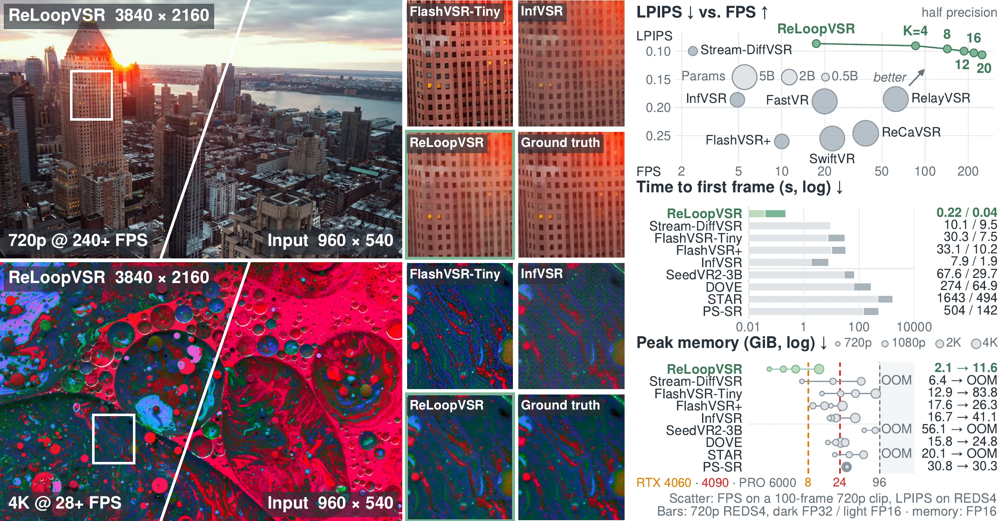
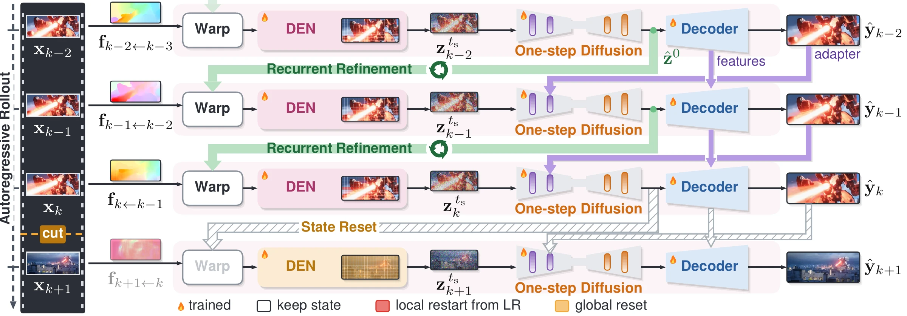

<h1 align="center">ReLoopVSR: One-Step Recurrent Autoregressive Diffusion<br>Refinement for Streaming Video Super-Resolution</h1>

<p align="center">
  <a href="https://ming053l.github.io/">Chia-Ming Lee</a><sup>1,2</sup>&nbsp;&nbsp;
  <a href="https://mingching.github.io/">Ming-Ching Chang</a><sup>1</sup>&nbsp;&nbsp;
  <a href="https://scholar.google.com/citations?user=gMBvzGoAAAAJ&hl=en">Xin Li</a><sup>1</sup>&nbsp;&nbsp;
  <a href="https://yulunalexliu.github.io/">Yu-Lun Liu</a><sup>2</sup>&nbsp;&nbsp;
  <a href="https://cchsu.info/">Chih-Chung Hsu</a><sup>2</sup>
</p>

<p align="center">
  <sup>1</sup>University at Albany, SUNY&nbsp;&nbsp;&nbsp;<sup>2</sup>National Yang Ming Chiao Tung University
</p>

<p align="center">
  <a href="https://ming053l.github.io/ReLoopVSR/"></a>
  
  
</p>

<p align="center">
  
</p>

> [!NOTE]
> **Code release:** code and weights will be released in this repository. Watch or star it to get notified.
> In the meantime, comparison videos and results are on the [project page](https://ming053l.github.io/ReLoopVSR/).

## Abstract

ReLoopVSR restores a video stream without future frames, in one denoising step per frame. It aligns and re-noises the previous restoration, refines it with the current low-resolution frame, and restarts wherever errors are predicted or the scene cuts. It leads in perceptual quality on six paired benchmarks with far lower memory and first-frame latency than existing streaming VSR methods, and **ReLoopVSR-fast** exceeds 240 FPS at 720p with 2.2 GiB of peak memory.

## Overview

<p align="center">
  
</p>

Each frame starts from the previous restoration instead of noise: the previous denoised latent is warped to the current frame with optical flow, re-noised, and refined in a single step under the current low-resolution frame. Tiles with low predicted error keep the aligned restoration, the others restart from the current frame, and a scene cut resets the whole state.

## Citation

If you find our work useful for your research, please consider citing us:

```bibtex
@misc{lee2026reloopvsr,
  title  = {ReLoopVSR: One-Step Recurrent Autoregressive Diffusion Refinement for Streaming Video Super-Resolution},
  author = {Lee, Chia-Ming and Chang, Ming-Ching and Li, Xin and Liu, Yu-Lun and Hsu, Chih-Chung},
  year   = {2026},
  note   = {Preprint}
}
```
